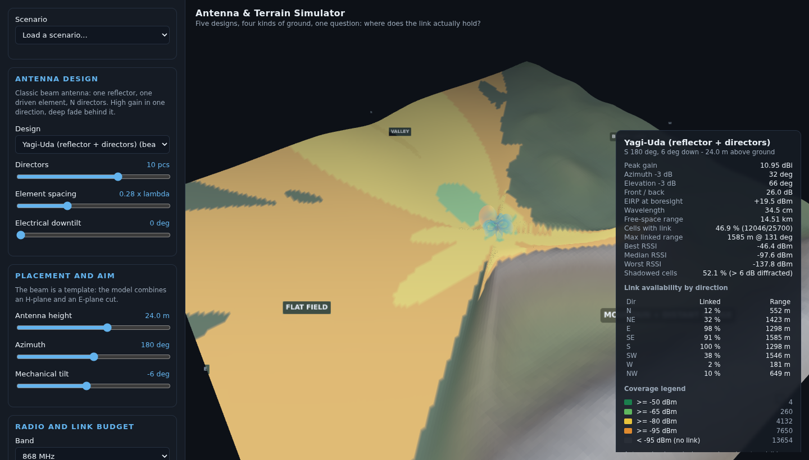

# Antenna & Terrain Simulator

A browser-based 3D sandbox for one question: **where does the link actually hold?**

An antenna stands on a flattened pad in the middle of a map. Around it, four kinds
of ground: a mountain to the north with a taller range behind it, an open flat
field to the east, a valley to the south, and rolling bumps to the west. Pick a
design, set the height and aim, and the simulator draws the radiation lobe and
paints the predicted signal level onto the terrain.


## Run it

There is nothing to install and nothing to build: the repository *is* the app.
Start any static file server in the project root and open it.

```bash
python3 -m http.server 8080     # or: npx serve .  /  php -S 127.0.0.1:8080
```

Then open <http://localhost:8080>. You need a browser with **WebGL2** - any
current Chrome, Firefox, Edge or Safari.

The only third-party library, a fixed minified build of three.js, is committed
under `vendor/three/` with its license and a hash manifest, so the page fetches
nothing from a CDN and runs the same bytes for everyone. Node.js (22 or newer) is
only needed for the development tools and the test suite - see
[Development](#development).

Two conveniences if you do have Node around: `npm run dev` serves the same thing
with no-cache headers and a `/-/health` endpoint, and `npm run browser -- shot`
takes screenshots headlessly.

If the page shows a red **"Startup failed"** banner, the banner repeats the
browser's own error - usually a missing `vendor/three/` file (`git clone` without
`--filter`, or a hand-edited import map).

## What you see

- **The ground**, coloured by height, with the four zones labelled on the map:
  `MOUNTAIN + DISTANT RANGE` (north), `FLAT FIELD` (east), `VALLEY` (south),
  `BUMPY LAND` (west).
- **The mast and antenna hardware** at the site. The mast is drawn at true height;
  the antenna body is enlarged so you can see what it is - treat the hardware as
  "not to scale".
- **The radiation lobe**: a 3D surface of the antenna's own gain, cut off 30 dB
  below the peak. It shows the shape of the antenna, not its range.
- **The coverage overlay**: signal level painted onto the ground, measured where
  the terrain actually is - so the far side of a ridge goes dark.

The read-out panel on the right reports what the current configuration delivers:
peak gain, the −3 dB beamwidths, front-to-back ratio, EIRP at boresight,
wavelength, the free-space range limit, how many map cells have a link, the best /
median / worst signal, how many cells are shadowed, and a per-direction table
across the eight compass sectors (N, NE, E, SE, S, SW, W, NW) showing how much of
each sector has a link and how far that link reaches.

Below the numbers is the legend: five colour bands, keyed to your receiver
sensitivity (for example `>= -40 dBm` down to `< -85 dBm (no link)`). Changing
sensitivity moves the boundaries - the colours mean "margin over what the client
can hear", not "signal quality" in the abstract.

## Controls

Left panel, top to bottom:

| Group | What you set |
| --- | --- |
| **Scenario** | Five ready-made setups to load (see below). |
| **Antenna design** | Which of the five designs, plus that design's own parameters (number of directors, loop turns, patch size, ...). |
| **Placement and aim** | Height above ground (0.5–40 m), azimuth (0–360°, 0 = north), mechanical tilt (−60° to +60°, negative is downtilt). |
| **Radio and link budget** | Band (433 / 868 / 915 / 2400 / 5800 MHz), transmitter power (−10…43 dBm), feeder loss, receiver sensitivity, evaluation range, clutter loss, and a switch for terrain shadowing. |
| **Terrain** | The terrain seed. Same seed always gives the same ground. |
| **Display** | Coverage overlay, radiation pattern, terrain mesh, zone labels. |

Buttons: **New terrain** (fresh random seed), **Reset view** (camera back to
start), **Save PNG** (download the current view), **Reset all**.

Some designs (Yagi, biquad, patch) also offer **electrical downtilt**: the beam
tips down while the hardware stays level, which is how a real sector panel is
often tilted.

### Move the camera

| Input | Effect |
| --- | --- |
| Drag | Orbit around the site |
| Wheel | Zoom in / out |
| Right-drag | Pan |
| Arrow keys | Orbit |
| `+` / `-` | Zoom |
| `h` | Hide the interface (press again to bring it back) |

### Shareable links

Everything on the panel can be set from the URL, which makes a configuration easy
to paste into a bug report:

```
http://localhost:8080/?design=yagi&seed=1234&height=24&azimuth=180&tilt=-6&frequency=2400&sensitivity=-95&range=1600
```

| Parameter | Sets | |
| --- | --- | --- |
| `preset` | one of the five scenarios | `site-sector`, `valley-reach`, `flat-field`, `mountain-shadow`, `bumps-hills` |
| `design` | antenna design | `omni-dipole`, `omni-collinear`, `yagi`, `biquad-reflector`, `patch` |
| `seed` | terrain seed | same number, same ground |
| `height`, `azimuth`, `tilt` | mast height (m), azimuth and tilt (deg) | |
| `frequency` | band in MHz | `433`, `868`, `915`, `2400`, `5800` |
| `sensitivity`, `range` | receiver sensitivity (dBm), evaluation range (m) | |
| `manual`, `nohud` | testing aids: no animation loop, no read-out panel | |



## The five designs

| Design | Beam | What it is good at |
| --- | --- | --- |
| **Omni half-wave dipole** | All directions, fat vertical lobe | Reference omni. Radiates everywhere, wastes power up and down. |
| **Omni collinear** | All directions, flattened vertical lobe | Long-range omni on a tower: more power at the horizon, less directly overhead. |
| **Yagi-Uda** | Narrow beam, deep null behind | Reaching one far place - straight down the flat field, or into the far end of the valley. |
| **Biquad with plate reflector** | Wide, forgiving sector | Covering a broad area in one direction, e.g. a campsite or a farm yard. |
| **Microstrip patch** | Neat sector, low profile | Sector coverage near the mast, especially with electrical downtilt. |

Aim controls only matter for the three directional designs - an omni does not
care which way it faces, and the panel says so.

## Presets worth trying

- **Reach down the valley** - long Yagi pointed south, tilted into the valley floor (the picture above).
- **Mountain shadow** - a high omni looking north; watch the dead zone appear behind the ridge, and the second dead zone in the far range's shadow.
- **Down the flat field** - Yagi east, where the link budget rather than the ground is the limit.
- **Over the bumps** - biquad west: gain helps, but grazing rays over the humps do not.
- **Sector around the site** - patch panel with downtilt covering the flattened ground around the mast.

## What the numbers mean

The prediction is a link budget evaluated per map cell:

```
RSSI = transmitter power - feeder loss + antenna gain toward that cell
       - free-space path loss - diffraction loss over the ground - clutter loss
```

Antenna gain comes from a model of each design's pattern, evaluated in the
direction of the cell, so pointing matters and so does tilt. Free-space loss uses
the real wavelength for your band: doubling distance or doubling frequency costs
about 6 dB. Terrain shadowing is modelled as knife-edge diffraction along the
actual ground profile, using standard-atmosphere Earth curvature - which is why a
ridge can cost 2 dB on one path and 25 dB on another.

### What this does not model

It is a planning toy, not a propagation site survey. Deliberately left out:
reflections and multipath fading, building and tree clutter (approximated by one
flat "clutter loss" slider), rain and vegetation loss, antenna noise and
interference, receiver desensitisation, terrain-pipe losses inside the valley
beyond diffraction, and everything about the return path (this is one-way RSSI).
The hardware geometry is drawn to be recognisable, not to scale.

## Development

Contributors: see [GUIDELINES.md](GUIDELINES.md) for the architecture rules,
testing policy and tooling. Quick version (needs Node 22+):

```bash
npm run vendor      # verify the vendored three.js against its manifest
npm run lint        # architecture + licensing + static-hosting rules
npm run test:unit   # pure maths + state, no browser
npm run test        # unit + headless-browser tests
npm run verify      # all of the above
```

## Deploying it anywhere

Because the entry point sits at the repository root and every URL in the page is
relative, it can be hosted from a sub-path without changes:

- **GitHub Pages**: push the repository, then set Pages to build from the
  `main` branch / root. No workflow, no build step.
- **Any web host**: copy `index.html`, `assets/`, `src/` and `vendor/`. Nothing else.
- **Double-clicking `index.html`** does not work - browsers refuse to load ES
  modules from `file://`. Serve it, even locally.

## Licence

The simulator is MIT licensed - see [LICENSE](LICENSE), © 2026 martin roos.

three.js is MIT licensed by its own authors; the exact shipped build, its
license text and the hashes of the upstream files it was built from live in
[`vendor/three/`](vendor/three) (`LICENSE.txt`, `NOTICE.md`, `manifest.json`).
Running `npm run vendor` verifies that the file the browser loads is byte for
byte the audited one.
