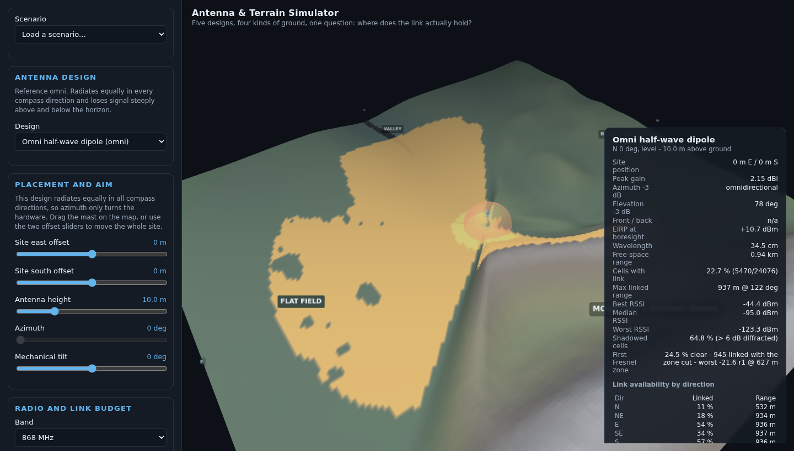

# Antenna & Terrain Simulator

A browser-based 3D sandbox for one question: **where does the link actually hold?**

An antenna stands on the ground wherever you put it. Around it, four kinds
of ground: a mountain to the north with a taller range behind it, an open flat
field to the east, a valley to the south, and rolling bumps to the west. Pick a
design, set the height and aim, and the simulator draws the radiation lobe and
paints the predicted signal level onto the terrain. Drag the mast (or use the two
placement sliders) and the mast, its hardware, its lobe and its coverage go with
it, while the mountain, the valley and every other hill stay exactly where they
are: the map never reshapes itself to suit the antenna. Put the mast on a ridge and
it stands on the ridge, with the ground falling away beside it.



## Run it

There is nothing to install and nothing to build: the repository *is* the app.
Start any static file server in the project root and open it.

```bash
python3 -m http.server 8080     # or: npx serve .  /  php -S 127.0.0.1:8080
```

Then open <http://localhost:8080>. You need a browser with **WebGL2** - any
current Chrome, Firefox, Edge or Safari.

The only third-party library, a fixed minified build of three.js, is committed
under `vendor/three/` with its license and a hash manifest, so the page fetches
nothing from a CDN and runs the same bytes for everyone. Node.js (22 or newer) is
only needed for the development tools and the test suite - see
[Development](#development).

Two conveniences if you do have Node around: `npm run dev` serves the same thing
on port 8080 with no-cache headers and a `/-/health` endpoint, and
`npm run browser -- shot` takes screenshots headlessly.

If the page shows a red **"Startup failed"** banner, the banner repeats the
browser's own error. It is almost always a missing file under `vendor/three/` or
an edited import map, and `npm run vendor` tells you which.

## What you see

- **The ground**, coloured by height, with the four zones labelled on the map:
  `MOUNTAIN + DISTANT RANGE` (north), `FLAT FIELD` (east), `VALLEY` (south),
  `BUMPY LAND` (west).
- **The mast and antenna hardware** at the site, which is a position on the map and
  not the middle of it. The mast is drawn at true height;
  the antenna body is enlarged so you can see what it is - treat the hardware as
  "not to scale". The foot of the mast *is* the drawn ground: the same sample the
  mesh is draped from and the coverage grid reads, so *Antenna height* is measured
  from the real surface under the mast and the mast can neither float nor sink. On a
  ridge flank that is blunt arithmetic - a 10 m mast below a crest sits below the
  crest, and the coverage says so. Nothing is flattened, cut or filled to make the
  antenna's location comfortable, and moving the mast moves no earth.
- **The radiation lobe**: a 3D surface of the antenna's own gain, cut off 30 dB
  below the peak. It shows the shape of the antenna, not its range.
- **The coverage overlay**: signal level painted onto the ground, measured where
  the terrain actually is - so the far side of a ridge goes dark.
- **The first Fresnel zone** (optional, off by default): switch on *Fresnel zone*
  in the Display group and two things happen. A semi-transparent tube appears along
  the boresight - the first Fresnel zone of a reference link from the mast to where
  the beam lands. And the coverage overlay switches from signal bands to zone
  clearance: green where the ground leaves the zone clear, amber where it eats into
  it, purple where it stands above the ray. The legend changes with it, because a
  legend that does not describe the colours under it is a bug.

The read-out panel on the right reports what the current configuration delivers:
peak gain, the −3 dB beamwidths, front-to-back ratio, EIRP at boresight,
wavelength, the free-space range limit, how many map cells have a link, the best /
median / worst signal, how many cells are shadowed, how many keep their first
Fresnel zone clear, and a per-direction table
across the eight compass sectors (N, NE, E, SE, S, SW, W, NW) showing how much of
each sector has a link and how far that link reaches.

Below the numbers is the legend: five colour bands, keyed to your receiver
sensitivity (for example `>= -40 dBm` down to `< -85 dBm (no link)`). Changing
sensitivity moves the boundaries - the colours mean "margin over what the client
can hear", not "signal quality" in the abstract. In the Fresnel-zone view the
legend becomes three rows - cut, partly cut, clear - and quotes the receiver height
the verdict was computed for.

## Controls

Left panel, top to bottom:

| Group | What you set |
| --- | --- |
| **Scenario** | Five ready-made setups to load (see below). |
| **Antenna design** | Which of the five designs, plus that design's own parameters (number of directors, loop turns, patch size, ...). |
| **Placement and aim** | Site position: east offset and south offset, −1200 to +1200 m in 5 m steps (the same numbers a drag writes). Height above ground (0.5–40 m, measured from the ground under the mast), azimuth (0–360°, 0 = north), mechanical tilt (−60° to +60°, negative is downtilt). |
| **Radio and link budget** | Band (433 / 868 / 915 / 2400 / 5800 MHz), transmitter power (−10…43 dBm), feeder loss, receiver sensitivity, zone receiver height, evaluation range, clutter loss, and a switch for terrain shadowing. |
| **Terrain** | The terrain seed. Same seed always gives the same ground. |
| **Display** | Coverage overlay, radiation pattern, Fresnel zone, terrain mesh, zone labels. |

Buttons: **New terrain** (fresh random seed), **Reset view** (camera back to
start, centred on the site), **Reset placement** (site back to the middle of the
map), **Save PNG** (download the current view), **Reset all** (everything, the site
included).

Some designs (Yagi, biquad, patch) also offer **electrical downtilt**: the beam
tips down while the hardware stays level, which is how a real sector panel is
often tilted.

### Move the camera

| Input | Effect |
| --- | --- |
| Drag | Orbit around the site |
| Drag the mast | Move the site: mast, hardware, lobe and coverage go with it; not one metre of ground does |
| Wheel | Zoom in / out |
| Right-drag or shift-drag | Pan |
| Arrow keys | Orbit |
| `+` / `-` | Zoom |
| `h` | Hide the interface (press again to bring it back) |

The cursor turns into a grab hand over the hardware, and grabs take priority over
orbiting, so you can always move the mast instead of swinging the camera - even
when the site has been moved off the middle of the map. Dragging and the two
placement sliders write the same state, so a drag can be undone with **Reset
placement** and shared with a link.

### Shareable links

Everything on the panel can be set from the URL, which makes a configuration easy
to paste into a bug report:

```
http://localhost:8080/?design=yagi&seed=1234&height=24&azimuth=180&tilt=-6&siteX=400&siteZ=-200&frequency=2400&sensitivity=-95&range=1600
```

| Parameter | Sets | |
| --- | --- | --- |
| `preset` | one of the five scenarios | `site-sector`, `valley-reach`, `flat-field`, `mountain-shadow`, `bumps-hills` |
| `design` | antenna design | `omni-dipole`, `omni-collinear`, `yagi`, `biquad-reflector`, `patch` |
| `seed` | terrain seed | same number, same ground |
| `height`, `azimuth`, `tilt` | mast height (m), azimuth and tilt (deg) | |
| `siteX`, `siteZ` | site position east / south, metres | off the map centre; both default to 0 |
| `frequency` | band in MHz | `433`, `868`, `915`, `2400`, `5800` |
| `sensitivity`, `range` | receiver sensitivity (dBm), evaluation range (m) | |
| `fresnel` | start in the Fresnel-zone view | `fresnel=1` (volume on, zone colours) |
| `manual`, `nohud` | testing aids: no animation loop, no read-out panel | |


## The five designs

| Design | Beam | What it is good at |
| --- | --- | --- |
| **Omni half-wave dipole** | All directions, fat vertical lobe | Reference omni. Radiates everywhere, wastes power up and down. |
| **Omni collinear** | All directions, flattened vertical lobe | Long-range omni on a tower: more power at the horizon, less directly overhead. |
| **Yagi-Uda** | Narrow beam, deep null behind | Reaching one far place - straight down the flat field, or into the far end of the valley. |
| **Biquad with plate reflector** | Wide, forgiving sector | Covering a broad area in one direction, e.g. a campsite or a farm yard. |
| **Microstrip patch** | Neat sector, low profile | Sector coverage near the mast, especially with electrical downtilt. |

Aim controls only matter for the three directional designs - an omni does not
care which way it faces, and the panel says so.

## Presets worth trying

- **Reach down the valley** - long Yagi pointed south, tilted into the valley floor (the picture above).
- **Mountain shadow** - a high omni looking north; watch the dead zone appear behind the ridge, and the second dead zone in the far range's shadow.
- **Down the flat field** - Yagi east, where the link budget rather than the ground is the limit.
- **Over the bumps** - biquad west: gain helps, but grazing rays over the humps do not.
- **Sector around the site** - patch panel with downtilt covering the ground around the mast.

## What the numbers mean

The prediction is a link budget evaluated per map cell:

```
RSSI = transmitter power - feeder loss + antenna gain toward that cell
       - free-space path loss - diffraction loss over the ground - clutter loss
```

Antenna gain comes from a model of each design's pattern, evaluated in the
direction of the cell, so pointing matters and so does tilt. Free-space loss uses
the real wavelength for your band: doubling distance or doubling frequency costs
about 6 dB. Terrain shadowing is modelled as knife-edge diffraction along the
actual ground profile, using standard-atmosphere Earth curvature - which is why a
ridge can cost 2 dB on one path and 25 dB on another.

### Decibels are not the same as a working link

Diffraction loss answers "how much does that hill cost?". It does not answer "is
this a link I trust?". For the second question the tool also checks the **first
Fresnel zone**: the ellipsoidal bubble of active space between the two antennas,
whose radius halfway along a path of length `D` is

```
r1 = sqrt(lambda * D / 4)      (at 1.4 km: 11 m at 868 MHz, 4.3 m at 5.8 GHz)
```

Anything standing inside that bubble disturbs the wave even when the straight ray
between the antennas is clear. The rule of thumb used here is the usual one: a path
is **clear** when the ground stays at least 60 % of `r1` below the ray everywhere
along it. The two measures are one physics seen twice - the diffraction parameter
this app charges decibels with is exactly `v = sqrt(2) * h / r1`, where `h` is the
height of the ray above the ground - so the zone flag is deliberately **not** an
extra loss term. Charging the same ridge twice would be a bug, not a model.

The point of reporting both is the population where they disagree: cells that make
their link budget with the zone cut. On the default map at 868 MHz that is 945 of
5470 linked cells - links that work on paper and misbehave in the field.

Two things follow from the criterion being a *ratio*, and both are visible in the
app rather than hidden in a constant:

- **It depends on the band.** A longer wavelength is a fatter zone, so more of it to
  cut: 17 % of the default map is zone-clear at 433 MHz, 25 % at 868 MHz, 43 % at
  5.8 GHz, with the same ground and the same study area.
- **It depends on how high the receiving terminal is.** Measured against a receiver
  lying on the ground, the zone closes to nothing at the receiver and the criterion
  is always failed - over flat ground a 10 m mast is only zone-clear inside
  `2.2 * (h1 + h2) / lambda`, which is 89 m at 868 MHz and not much better anywhere
  else. So the app asks for a *zone receiver height* (default 4 m: a client on a
  roof or a short pole) and prints that number in the legend and in
  `window.__sim.fresnel()`. Move the slider and the map changes; the decibels do
  not, because the diffraction loss is still charged for the ray that ends on the
  cell's own ground.

The drawn volume is the zone of one reference link - the boresight out to where it
reaches the ground, at a terminal one receiver-height above it - because that is the
largest zone the antenna has to keep clear anywhere it is looking. Its radius is
widened by a fixed factor so it is visible next to a kilometre-wide map; at
`FRESNEL.radialExaggeration: 1` you would see the truth, which is a hairline.


Green keeps at least 60 % of the first zone clear, amber is partly cut, purple is
cut outright - the ground stands above the ray. The read-out panel puts the same
numbers in words: how much of the map is clear, how many cells have the budget but
not the zone, and the worst clearance on the map with the distance it happened at.

### What this does not model

It is a planning toy, not a propagation site survey. Deliberately left out:
reflections and multipath fading (the zone flag hints at where ground reflection
would matter, it does not compute it), building and tree clutter (approximated by
one flat "clutter loss" slider), rain and vegetation loss, antenna noise and
interference, receiver desensitisation, terrain-pipe losses inside the valley
beyond diffraction, multi-point and terrain-reflected propagation models beyond the
single knife edge, and everything about the return path (this is one-way RSSI).
The hardware geometry is drawn to be recognisable, not to scale.

## Development

Contributors: see [GUIDELINES.md](GUIDELINES.md) for the architecture rules,
testing policy and tooling. Quick version (needs Node 22+):

```bash
npm run vendor      # verify the vendored three.js against its manifest
npm run lint        # architecture + licensing + static-hosting rules
npm run test:unit   # pure maths + state, no browser
npm run test        # unit + headless-browser tests
npm run verify      # all of the above
```

## Deploying it anywhere

Because the entry point sits at the repository root and every URL in the page is
relative, it can be hosted from a sub-path without changes:

- **GitHub Pages**: push the repository, then set Pages to build from the
  `main` branch / root. No workflow, no build step.
- **Any web host**: copy `index.html`, `assets/`, `src/` and `vendor/`. Nothing else.
- **Double-clicking `index.html`** does not work - browsers refuse to load ES
  modules from `file://`. Serve it, even locally.

## Licence

The simulator is MIT licensed - see [LICENSE](LICENSE), © 2026 martin roos.

three.js is MIT licensed by its own authors; the exact shipped build, its
license text and the hashes of the upstream files it was built from live in
[`vendor/three/`](vendor/three) (`LICENSE.txt`, `NOTICE.md`, `manifest.json`).
Running `npm run vendor` verifies that the file the browser loads is byte for
byte the audited one.
