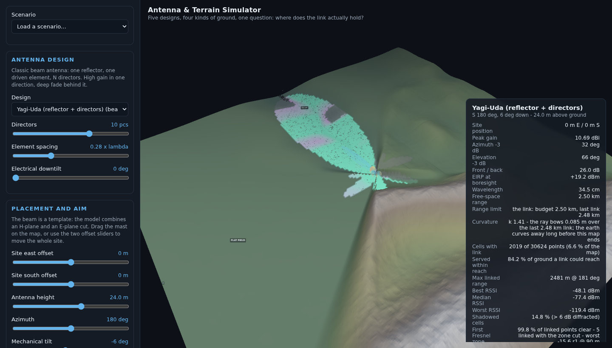

# Antenna & Terrain Simulator

A browser-based 3D sandbox for one question: **where does the link actually hold?**

An antenna stands on the ground wherever you put it - a 5.2 km square map, sampled
every 15 m. Around it, four kinds of
ground: a mountain to the north with a taller range behind it, an open flat
field to the east, a valley to the south, and rolling bumps to the west. Pick a
design, set the height and aim, and the simulator draws the radiation lobe and
paints the predicted signal level onto the terrain. Drag the mast (or use the two
placement sliders) and the mast, its hardware, its lobe and its coverage go with
it, while the mountain, the valley and every other hill stay exactly where they
are: the map never reshapes itself to suit the antenna. Put the mast on a ridge and
it stands on the ridge, with the ground falling away beside it.


## Run it

There is nothing to install and nothing to build: the repository *is* the app.
Start any static file server in the project root and open it.

```bash
python3 -m http.server 8080     # or: npx serve .  /  php -S 127.0.0.1:8080
```

Then open <http://localhost:8080>. You need a browser with **WebGL2** - any
current Chrome, Firefox, Edge or Safari.

The only third-party library, a fixed minified build of three.js, is committed
under `vendor/three/` with its license and a hash manifest, so the page fetches
nothing from a CDN and runs the same bytes for everyone. Node.js (22 or newer) is
only needed for the development tools and the test suite - see
[Development](#development).

Two conveniences if you do have Node around: `npm run dev` serves the same thing
on port 8080 with no-cache headers and a `/-/health` endpoint, and
`npm run browser -- shot` takes screenshots headlessly.

If the page shows a red **"Startup failed"** banner, the banner repeats the
browser's own error. It is almost always a missing file under `vendor/three/` or
an edited import map, and `npm run vendor` tells you which.

## What you see

- **The ground**, coloured by height, with the four zones labelled on the map:
  `MOUNTAIN + DISTANT RANGE` (north), `FLAT FIELD` (east), `VALLEY` (south),
  `BUMPY LAND` (west).
- **The mast and antenna hardware** at the site, which is a position on the map and
  not the middle of it. The mast is drawn at true height;
  the antenna body is enlarged so you can see what it is - treat the hardware as
  "not to scale". The foot of the mast *is* the drawn ground: the same sample the
  mesh is draped from and the coverage grid reads, so *Antenna height* is measured
  from the real surface under the mast and the mast can neither float nor sink. On a
  ridge flank that is blunt arithmetic - a 10 m mast below a crest sits below the
  crest, and the coverage says so. Nothing is flattened, cut or filled to make the
  antenna's location comfortable, and moving the mast moves no earth.
- **The radiation lobe**: a 3D surface of the antenna's own gain, cut off 30 dB
  below the peak. It shows the shape of the antenna, not its range.
- **The coverage overlay**: signal level painted onto the ground, measured where
  the terrain actually is - so the far side of a ridge goes dark. The map is 5.2 km
  across, the ground is sampled every 15 m and the coverage every 30 m, and the sweep
  looks at the **whole map**, not a disc around the mast. Three strengths, three
  meanings: solid colour where a link works, a faint wash where the sweep asked and the
  terrain defeated the link, and no paint at all where the free-space budget cannot reach
  the receiver - ground that was never consulted, and that therefore makes no claim.
  **The outer edge of the colour is where the link dies.** If something of ours would cut
  the search off first - the study range you set, or the edge of the map - a pale ring
  appears at that radius, the still-alive directions are marked `>=` in the direction
  table, and the read-out names the limit that bit and what the link would have reached
  without it.
- **The first Fresnel zone** (optional, off by default): switch on *Fresnel zone*
  in the Display group and two things happen. A semi-transparent tube appears along
  the boresight - the first Fresnel zone of a reference link from the mast to where
  the beam lands. And the coverage overlay switches from signal bands to zone
  clearance: green where the ground leaves the zone clear, amber where it eats into
  it, purple where it stands above the ray. The legend changes with it, because a
  legend that does not describe the colours under it is a bug.

The read-out panel on the right reports what the current configuration delivers:
peak gain, the −3 dB beamwidths, front-to-back ratio, EIRP at boresight,
wavelength, the free-space range, the **range limit** (one line saying whether what you
are looking at ends because of the link, your study range, or the edge of the map), how
many cells have a link both as a share of the map and as a share of the ground a link
could reach, the best / median / worst signal, how many cells are shadowed, how many of
the *linked* cells keep their first Fresnel zone clear, and a per-direction table
across the eight compass sectors (N, NE, E, SE, S, SW, W, NW) showing how much of
each sector has a link and how far that link reaches - a range printed as `>= 1400 m`
was still alive where we stopped looking.

Below the numbers is the legend: four colour bands and a faint row, keyed to your
receiver sensitivity (at the default −80 dBm that is `>= -35 dBm`, `>= -50`, `>= -65`,
`>= -80`, then `< -80 dBm (faint: terrain stops the link)`), plus a row for the bare
"out of budget - not measured, not painted" area. Changing sensitivity moves the
boundaries - the colours mean "margin over what the client can hear", not "signal
quality" in the abstract. In the Fresnel-zone view the legend becomes three rows - cut,
partly cut, clear - and quotes the receiver height the verdict was computed for.

## Controls

Left panel, top to bottom:

| Group | What you set |
| --- | --- |
| **Scenario** | Five ready-made setups to load (see below). |
| **Antenna design** | Which of the five designs, plus that design's own parameters (number of directors, loop turns, patch size, ...). |
| **Placement and aim** | Site position: east offset and south offset, −2500 to +2500 m in 5 m steps (the same numbers a drag writes). Height above ground (0.5–40 m, measured from the ground under the mast), azimuth (0–360°, 0 = north), mechanical tilt (−60° to +60°, negative is downtilt). |
| **Radio and link budget** | Band (433 / 868 / 915 / 2400 / 5800 MHz), transmitter power (−10…43 dBm), feeder loss, receiver sensitivity, zone receiver height, study range (100 m up to the whole map), clutter loss, and a switch for terrain shadowing. |
| **Terrain** | The terrain seed. Same seed always gives the same ground. |
| **Display** | Coverage overlay, radiation pattern, Fresnel zone, terrain mesh, zone labels. |

Buttons: **New terrain** (fresh random seed), **Reset view** (camera back to
start, centred on the site), **Reset placement** (site back to the middle of the
map), **Save PNG** (download the current view), **Reset all** (everything, the site
included).

Some designs (Yagi, biquad, patch) also offer **electrical downtilt**: the beam
tips down while the hardware stays level, which is how a real sector panel is
often tilted.

### Move the camera

| Input | Effect |
| --- | --- |
| Drag | Orbit around the site |
| Drag the mast | Move the site: mast, hardware, lobe and coverage go with it; not one metre of ground does |
| Wheel | Zoom in / out |
| Right-drag or shift-drag | Pan |
| Arrow keys | Orbit |
| `+` / `-` | Zoom |
| `h` | Hide the interface (press again to bring it back) |

The cursor turns into a grab hand over the hardware, and grabs take priority over
orbiting, so you can always move the mast instead of swinging the camera - even
when the site has been moved off the middle of the map. Dragging and the two
placement sliders write the same state, so a drag can be undone with **Reset
placement** and shared with a link.

### Shareable links

Everything on the panel can be set from the URL, which makes a configuration easy
to paste into a bug report:

```
http://localhost:8080/?design=yagi&seed=1234&height=24&azimuth=180&tilt=-6&siteX=400&siteZ=-200&frequency=2400&sensitivity=-95&range=1600
```

| Parameter | Sets | |
| --- | --- | --- |
| `preset` | one of the five scenarios | `site-sector`, `valley-reach`, `flat-field`, `mountain-shadow`, `bumps-hills` |
| `design` | antenna design | `omni-dipole`, `omni-collinear`, `yagi`, `biquad-reflector`, `patch` |
| `seed` | terrain seed | same number, same ground |
| `height`, `azimuth`, `tilt` | mast height (m), azimuth and tilt (deg) | |
| `siteX`, `siteZ` | site position east / south, metres | off the map centre; both default to 0 |
| `frequency` | band in MHz | `433`, `868`, `915`, `2400`, `5800` |
| `sensitivity`, `range` | receiver sensitivity (dBm), study range (m) | both clamped to what the model allows, and the clamp is reported - see below |
| `fresnel` | start in the Fresnel-zone view | `fresnel=1` (volume on, zone colours) |
| `manual`, `nohud` | testing aids: no animation loop, no read-out panel | |

A value outside the model is clamped rather than obeyed, and the clamp is not swallowed:
`window.__simBoot.overrides` lists what was asked for and what was applied, so a picture
limited by a bad link can be told apart from one limited by a URL that asked for the
impossible. `?range=99999&siteX=99999` on a 5.2 km map, for instance, applies 3800 m and
2500 m and says so.


## The five designs

| Design | Beam | What it is good at |
| --- | --- | --- |
| **Omni half-wave dipole** | All directions, fat vertical lobe | Reference omni. Radiates everywhere, wastes power up and down. |
| **Omni collinear** | All directions, flattened vertical lobe | Long-range omni on a tower: more power at the horizon, less directly overhead. |
| **Yagi-Uda** | Narrow beam, deep null behind | Reaching one far place - straight down the flat field, or into the far end of the valley. |
| **Biquad with plate reflector** | Wide, forgiving sector | Covering a broad area in one direction, e.g. a campsite or a farm yard. |
| **Microstrip patch** | Neat sector, low profile | Sector coverage near the mast, especially with electrical downtilt. |

Aim controls only matter for the three directional designs - an omni does not
care which way it faces, and the panel says so.

## Presets worth trying

Every one of them is tuned so that **its own link** is the last thing to give out: none
of the five is cut off by the study range or by the edge of the map, and a unit test fails
if one ever is (`coverage: no preset is cut off by our own limits`).

- **Reach down the valley** - long Yagi pointed south, tilted into the valley floor (the
  picture above). 2.48 km of link against a 2.50 km budget, and 99 % of those linked
  points keep the first zone clear: an open valley is good real estate.
- **Mountain shadow** - a high omni looking north; watch the dead zone appear behind the
  ridge, and the second dead zone in the far range's shadow. 7064 linked points, last one
  at 2.04 km of a 2.05 km budget.
- **Down the flat field** - Yagi east, where the link budget rather than the ground is
  the limit: the last link sits at 2004 m of a 2018 m budget, and 91 % of the linked
  points are zone-clear. This only works with the mast at 25 m; the same antenna at 10 m
  dies at 897 m and keeps only 21 % of its few links zone-clear, because a terminal on the
  ground has a radio horizon.
- **Over the bumps** - biquad west: 3.32 km of budget, and the ground lets it reach
  1.36 km. Gain helps; grazing rays over the humps do not.
- **Sector around the site** - patch panel with electrical downtilt: the beam is tipped
  into the ground, so the served ring hugs the mast. 3838 linked points, the last at
  3.01 km against a 3.08 km budget. Along the depressed boresight the first 200 m keep
  their first Fresnel zone clear and nothing past 400 m does - 54 % of its linked points
  are zone-clear, the worst of the five, because a panel aiming at the dirt cuts its own
  zone.

## What the numbers mean

The prediction is a link budget evaluated per map cell:

```
RSSI = transmitter power - feeder loss + antenna gain toward that cell
       - free-space path loss - diffraction loss over the ground - clutter loss
```

Antenna gain comes from a model of each design's pattern, evaluated in the
direction of the cell, so pointing matters and so does tilt. Free-space loss uses
the real wavelength for your band: doubling distance or doubling frequency costs
about 6 dB. Terrain shadowing is modelled as knife-edge diffraction along the
actual ground profile, using standard-atmosphere Earth curvature - which is why a
ridge can cost 2 dB on one path and 25 dB on another.

At the default 10 dBm into a receiver that hears −80 dBm, the five designs have these
free-space ranges, and that is the order the pictures follow when the ground allows it:
Yagi 2.20 km, biquad 1.86 km, collinear 1.67 km, patch 1.57 km, dipole 0.94 km. A
directional design's gain here is *derived from the beam it draws* (see
[Antenna physics](#antenna-physics-why-a-wide-antenna-cannot-have-long-reach) below), so
no slider can buy a gain its beamwidth would not survive.

### What the edge of the colour is

It is worth being exact about this, because a coverage picture whose edge means the wrong
thing is worse than no picture. Three things can end the colour, and the app tells you
which one did:

- **The link.** The budget runs out: the free-space figure falls below your receiver
  sensitivity and the ground cannot do anything about it. This is the answer you want,
  and by default it is what you get - the read-out prints
  `the link: budget 0.94 km, last link 0.94 km`.
- **Your study range.** *Study range* is a work area, not a prediction: it says how far
  from the mast the sweep is willing to look. At the maximum it is the whole map, and no
  ring is drawn because a ring that cannot bind only teaches you to ignore it. Lower it
  and the ring appears, points beyond it are not measured at all (no paint, no counts),
  and any direction that was still linked where the search stopped is printed as
  `>= <range>`. The read-out then says `our study range 1.40 km - the link would reach
  1.67 km`.
- **The edge of the map.** A big enough antenna on a small enough map: the search walks
  off the world. Then it says `edge of the map 0.30 km - the link would reach 11.82 km`.

Two shares are printed, because one number without its denominator is how a small link on
a big map gets read as a broken antenna: *Cells with link* is the share of the whole map
(the default dipole serves 844 of 30624 evaluated points - 2.8 %), while *Served within
reach* is the share of the ground where a link was physically possible at all (29.8 %).
The Fresnel percentages are stated over a third denominator, the linked set, because a
zone verdict about a point that cannot receive anything is not information.

Beyond the budget radius the app does not walk a ray; it stores the free-space upper
bound and paints nothing. That is a shortcut, not an approximation: diffraction and
clutter can only subtract, so if free space alone already misses your sensitivity the
ground cannot rescue the link. `coverage: the budget pre-filter cannot move the link
boundary` proves it on the real map - same linked set, same bands, bit-identical
decibels at every walked point, and every dismissed point demonstrably unreachable.

### Antenna physics: why a wide antenna cannot have long reach

Gain and beamwidth are the same fact stated twice. An antenna that puts 12.4 dBi into a
beam 69 degrees wide in both planes is not a strong antenna, it is two numbers that were
never reconciled - a 69 x 69 degree beam holds about 9.4 dBi, and that ceiling is
arithmetic, not a preference. This app now derives every directional design's gain from
the beamwidths it draws, times an aperture efficiency for the losses a real build has
(0.60 for a Yagi, 0.75 for a biquad, 0.55 for a patch; `ANTENNA.apertureEfficiency`), so
the lobe on screen and the decibels in the link budget cannot disagree:

| design | peak gain | -3 dB beamwidth | free-space range at 10 dBm / -80 dBm |
| --- | --- | --- | --- |
| Yagi (7 directors) | 9.6 dBi | 42 x 66 deg | 2.20 km |
| Biquad with plate reflector | 8.1 dBi | 69 x 69 deg | 1.86 km |
| Collinear (4 sections) | 7.2 dBi | 360 x 45 deg | 1.67 km |
| Patch panel | 6.7 dBi | 72 x 68 deg | 1.57 km |
| Half-wave dipole | 2.2 dBi | 360 x 78 deg | 0.94 km |

The two omni designs keep an array-factor gain instead - a half-wave dipole is 2.15 dBi and
N in-phase sections add `10*log10(N)` less a decibel for the feed - because a 360 degree
azimuth plane is not a main lobe and the beam-to-gain arithmetic above does not apply to it.
The reflector plate on the biquad still earns its keep, but in the front-to-back ratio
(17 dB at a close plate, 26 dB at a far one), which is what a plate actually buys.

### Why two antennas of different gain can look the same size

They are not the same, and the numbers say so; but on this ground the difference is often
not in *range*. On the flat field west of centre with the mast at 40 m, the five designs
reach 0.93, 1.39, 1.66, 1.70 and 2.17 km in exactly the order of their gains. The dipole,
collinear and Yagi each finish within 1.5 % of their own free-space figures; the patch and
the biquad get to 89 % and 91 % of theirs, because a beam that narrow-loud still has edges
and those edges find rising ground at the far end of the field. That ordering is a browser
test, so the app cannot quietly stop showing the difference.

Move the same antennas to the map centre at the default 10 m mast and the order scrambles:
the Yagi reaches 0.96 km of its 2.20 km budget, the patch 0.93 km of 1.57 km, and the
biquad - lowest gain of the three - reaches furthest at 1.24 km of 1.86 km. Nothing is
broken. A narrow beam pointed at the rise east of the centre drives straight into it, while
a wide beam spills past the same rise onto ground that is still in sight. Gain is a
property of the antenna; range is a property of the antenna *and* the ground, and the map
is where you see which of them is answering.

### Decibels are not the same as a working link

Diffraction loss answers "how much does that hill cost?". It does not answer "is
this a link I trust?". For the second question the tool also checks the **first
Fresnel zone**: the ellipsoidal bubble of active space between the two antennas,
whose radius halfway along a path of length `D` is

```
r1 = sqrt(lambda * D / 4)      (at 1.4 km: 11 m at 868 MHz, 4.3 m at 5.8 GHz)
```

Anything standing inside that bubble disturbs the wave even when the straight ray
between the antennas is clear. The rule of thumb used here is the usual one: a path
is **clear** when the ground stays at least 60 % of `r1` below the ray everywhere
along it. The two measures are one physics seen twice - the diffraction parameter
this app charges decibels with is exactly `v = sqrt(2) * h / r1`, where `h` is the
height of the ray above the ground - so the zone flag is deliberately **not** an
extra loss term. Charging the same ridge twice would be a bug, not a model.

The point of reporting both is the population where they disagree: cells that make
their link budget with the zone cut. On the default map at 868 MHz the omni dipole
links 844 points and 117 of them (13.9 %) do it with the first zone cut - links that
work on paper and misbehave in the field. Stated the other way round, 86.1 % of the
linked points are zone-clear; the 27796 points the budget dismissed are not in that
number, because the app never asked the ground about them.

Two things follow from the criterion being a *ratio*, and both are visible in the
app rather than hidden in a constant:

- **It depends on the band.** A longer wavelength is a fatter zone, so more of it to
  cut. With the same ground and the same receiver, of the points that actually link:
  70.6 % clear at 433 MHz, 86.1 % at 868 MHz, 93.7 % at 2.4 GHz, 100 % at 5.8 GHz. Read
  that last one carefully: at 5.8 GHz only 12 points link at all on the default
  configuration, because a 140 m budget leaves almost nothing to have an opinion about.
  The percentage is honest; the sample is the story.
- **It depends on how high the receiving terminal is.** Measured against a receiver
  lying on the ground, the zone closes to nothing at the receiver and the criterion
  is always failed - over flat ground a 10 m mast is only zone-clear inside
  `2.2 * (h1 + h2) / lambda`, which is 89 m at 868 MHz and not much better anywhere
  else. So the app asks for a *zone receiver height* (default 4 m: a client on a
  roof or a short pole) and prints that number in the legend and in
  `window.__sim.fresnel()`. Move the slider and the map changes; the decibels do
  not, because the diffraction loss is still charged for the ray that ends on the
  cell's own ground.

The drawn volume is the zone of one reference link - the boresight out to where it
reaches the ground, at a terminal one receiver-height above it - because that is the
largest zone the antenna has to keep clear anywhere it is looking. Its radius is
widened by a fixed factor so it is visible next to a five-kilometre map; at
`FRESNEL.radialExaggeration: 1` you would see the truth, which is a hairline.



Green keeps at least 60 % of the first zone clear, amber is partly cut, purple is
cut outright - the ground stands above the ray. The read-out panel puts the same
numbers in words: how much of the *linked* set is clear, how many cells have the budget
but not the zone, and the worst clearance on the map with the distance it happened at.

### What this does not model

It is a planning toy, not a propagation site survey. Deliberately left out:
reflections and multipath fading (the zone flag hints at where ground reflection
would matter, it does not compute it), building and tree clutter (approximated by
one flat "clutter loss" slider), rain and vegetation loss, antenna noise and
interference, receiver desensitisation, terrain-pipe losses inside the valley
beyond diffraction, multi-point and terrain-reflected propagation models beyond the
single knife edge, and everything about the return path (this is one-way RSSI).
The hardware geometry is drawn to be recognisable, not to scale.

Two limits of the *tool* are worth naming here as well, because both can be mistaken for
physics. The study range is a work area chosen for the sweep - a maximum of the whole map,
so by default nothing is cut off, and if you lower it the ring and the `>=` marks say so.
And inside the sweep, ground beyond the free-space budget is never ray-walked: that is a
shortcut whose worst case is provably a point that could not have linked anyway (see
[What the edge of the colour is](#what-the-edge-of-the-colour-is)), and its result is
painted as "not measured" rather than as a verdict.

## Development

Contributors: see [GUIDELINES.md](GUIDELINES.md) for the architecture rules,
testing policy and tooling. Quick version (needs Node 22+):

```bash
npm run vendor      # verify the vendored three.js against its manifest
npm run lint        # architecture + licensing + static-hosting rules
npm run test:unit   # pure maths + state, no browser
npm run test        # unit + headless-browser tests
npm run verify      # all of the above
```

## Deploying it anywhere

Because the entry point sits at the repository root and every URL in the page is
relative, it can be hosted from a sub-path without changes:

- **GitHub Pages**: push the repository, then set Pages to build from the
  `main` branch / root. No workflow, no build step.
- **Any web host**: copy `index.html`, `assets/`, `src/` and `vendor/`. Nothing else.
- **Double-clicking `index.html`** does not work - browsers refuse to load ES
  modules from `file://`. Serve it, even locally.

## Licence

The simulator is MIT licensed - see [LICENSE](LICENSE), © 2026 martin roos.

three.js is MIT licensed by its own authors; the exact shipped build, its
license text and the hashes of the upstream files it was built from live in
[`vendor/three/`](vendor/three) (`LICENSE.txt`, `NOTICE.md`, `manifest.json`).
Running `npm run vendor` verifies that the file the browser loads is byte for
byte the audited one.
